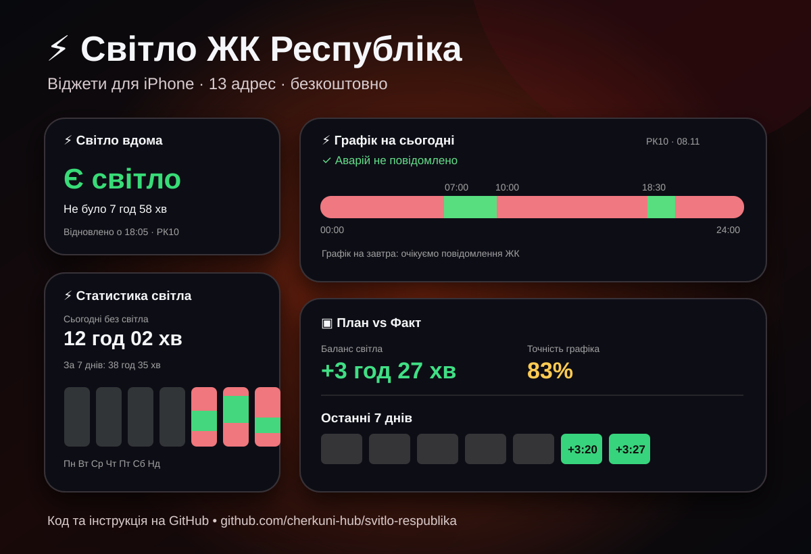

# Світло ЖК «Республіка» — iPhone (Scriptable)

**[⬇️ Завантажити готовий ZIP v1.0.1](https://github.com/cherkuni-hub/svitlo-respublika/releases/download/v1.0.1/Svitlo_Respublika_iPhone_v1.0.1.zip)** · [Усі релізи](https://github.com/cherkuni-hub/svitlo-respublika/releases)

Версія: **1.0.1**. Джерело: 9 скриптів з архіву власника, переданого 8 листопада 2026 року.
Це неофіційний набір віджетів для мешканців ЖК. Працює **локально на кожному iPhone**, без сервера, Telegram-бота й доступу до адміністрування каналу.

## Що встановити

1. **Scriptable** з App Store (дозвольте iCloud Drive і сповіщення).
2. **Telegram**: ви маєте бути учасником каналу **«🔊 ЖК Республіка: Сповіщення»**, звідки надходять повідомлення про фактичні увімкнення, вимкнення світла, графіки та аварії. **Увімкніть сповіщення** для цього каналу.
3. **Команди (Shortcuts)** — стандартний застосунок Apple.

## Встановлення комплекту

1. [Завантажте готовий ZIP v1.0.1](https://github.com/cherkuni-hub/svitlo-respublika/releases/download/v1.0.1/Svitlo_Respublika_iPhone_v1.0.1.zip) з розділу **Releases**, потім розпакуйте його в застосунку **Файли**.
2. У **Файли → iCloud Drive → Scriptable** скопіюйте **лише файл `INSTALL.js`** (не папку `source`, вона для публікації на GitHub). Якщо Scriptable не зберігає скрипти в iCloud, спочатку ввімкніть синхронізацію Scriptable з iCloud.
3. Відкрийте Scriptable та запустіть `INSTALL`.
4. Виберіть свою адресу із запропонованих 13. Установник створить 9 скриптів з префіксом **«Республіка · »**. Скрипти читають і записують дані лише на вашому iPhone.
5. **Не перейменовуйте** створені скрипти, якщо вже налаштували на них автоматизації.

Адреси: **Т4А, ТР1, ТР3, РК2А, ТР5, РК4, РК6, ТР4, БШ7, БШ9, БШ10/8, РК10, БШ8**.

## Налаштувати Telegram → Shortcuts (це обов’язково)

Потрібні **дві окремі персональні автоматизації**: 

1. `Команди → Автоматизація → + → Сповіщення` (назва пункту залежить від версії iOS). Оберіть **Telegram**. У фільтрі заголовка встановіть **Title → contains → `ЖК Республіка: Сповіщення`** (саме цей текст, **не довільний приклад**).
2. У діях виберіть **Scriptable → Run Script**, скрипт **«Республіка · Світло вдома»**, параметр **Notification → Body** (основний текст сповіщення). Увімкніть автоматичний запуск без запитання, якщо iOS це дозволяє.
3. Створіть **другу** автоматизацію з тим самим тригером, але зі скриптом **«Республіка · Імпорт графіка»** і тим самим **Notification → Body**.

**Увага:** потрібен саме канал **«🔊 ЖК Республіка: Сповіщення»**. У фільтрі Shortcuts використовуйте **`ЖК Республіка: Сповіщення`**: умова `contains` дозволяє наявність емодзі перед текстом заголовка. Не налаштовуйте тригер на інші чати. Перевірте, що в Scriptable дозволені сповіщення для помилок розпізнавання.

**Критичне обмеження:** якщо ви відкрили канал і Telegram не показав системного сповіщення, Shortcuts може не запуститися. Повністю автоматичного способу відновити такі повідомлення без зовнішнього джерела даних цей комплект не має. Історія світла починається з першої розпізнаної події; минулі події не вигадуються.

## Додати віджети на екран iPhone

Утримуйте головний екран → `+` → **Scriptable** → оберіть розмір → додайте. У налаштуваннях доданого віджета виберіть відповідний скрипт:

| Скрипт | Для чого | Розмір |
|---|---|---|
| Республіка · Світло вдома.js | Актуальний стан світла | Small |
| Республіка · Світло вдома - Lock.js | Статус на екрані блокування | Lock Screen |
| Республіка · Графік сьогодні+завтра.js | Планові графіки, аварії | Large |
| Республіка · План vs Факт.js | Порівняння плану й факту, детальний звіт | Large |
| Республіка · Статистика 7 днів.js | Статистика за тиждень | Medium |
| Республіка · Статистика місяць.js | Статистика за місяць | Large |

**Імпорт графіка**, **Перевірка повідомлень** і **Відновити подію світла** — службові скрипти, їх не потрібно ставити як віджети.

## Як виправляти помилки

- Якщо імпортер повідомляє про незнайомий формат, відкрийте **«Республіка · Перевірка повідомлень»**. Підтверджені нові формулювання статусу можна запам'ятати; довільний новий формат графіка не вивчається автоматично.
- Якщо пропущено фактичне перемикання, вручну запустіть **«Республіка · Відновити подію світла»** та введіть дату, час і стан за оригінальним повідомленням.
- Повідомлення **Automation failed** означає помилку Shortcuts, а не обов’язково втрату події. Перевірте дані перед ручним відновленням, щоб уникнути дублювання.
- Для оновлення версії збережіть локальну історію; запуск `INSTALL` ще раз замінить код створених скриптів, але **не очищає** файли даних. Не міняйте адресу, якщо у вас уже є історія іншої адреси: інакше статистика змішається.

## Важливі файли та приватність

Публічний ZIP містить **лише код**, а не ваші `light-history.json`, `light-home.json`, графіки, навчальні правила чи журнали. Усі скрипти використовують локальні файли Scriptable (`FileManager.local()`), тому дані кожного мешканця окремі.

## Зворотний зв’язок

Якщо знайшли помилку, не працює автоматизація або маєте пропозицію щодо віджетів:

- **Telegram:** [@cherkungt](https://t.me/cherkungt) — можна написати напряму.
- **GitHub Issues:** [повідомити про проблему або запропонувати покращення](https://github.com/cherkuni-hub/svitlo-respublika/issues) — зручно для обговорень та відстеження виправлень.

Для створення Issue потрібен акаунт GitHub і доступ до репозиторію. **Поки він приватний, сусіди без запрошення не зможуть переглядати його чи писати в Issues**. Після відкриття репозиторію вони зможуть подавати Issues, якщо ця функція буде ввімкнена.

Не надсилайте в Issues персональні дані або секрети.

## Перевірка перед поширенням

Установник створює адаптовані скрипти на основі 9 отриманих вихідних файлів. Синтаксис згенерованих JavaScript для всіх 13 адрес перевірено автоматично; на iPhone успішно перевірено статус, імпорт графіка та аварію для РК2А, але **реальну роботу на iPhone та імпорт усіх варіантів Telegram-повідомлень потрібно перевірити на пристрої**, перш ніж широко розсилати ZIP.

Автор не пов'язаний із Yasno/ДТЕК/адміністрацією ЖК.

## Виправлення у v1.0.1

- Усунуто збій `Alerts are not supported in Siri` при запуску імпортера графіка через Shortcuts: застосовується `config.runsWithSiri`.
- Перевірено вручну на тестовій адресі РК2А: перемикання світла, плановий графік і аварійне повідомлення.
- Інші скрипти не змінювалися порівняно з вихідним архівом користувача.
- Код і README розміщено в цьому GitHub-репозиторії. GitHub Release **v1.0.1** містить готовий інсталяційний ZIP.
